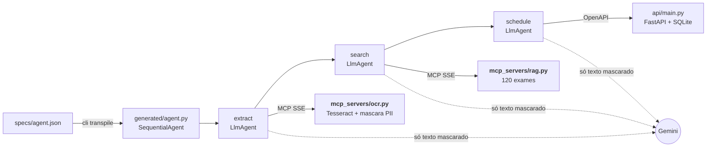

# Agendador de exames com Google ADK

Do pedido médico em foto ao agendamento confirmado. Um JSON, a spec, descreve o agente, e o transpilador gera dele o código Google ADK. O agente lê a foto por OCR, acha o código de cada exame por RAG (os dois via MCP) e agenda numa API FastAPI. O OCR mascara os dados pessoais antes de qualquer LLM. Tudo roda em Docker Compose.

É um projeto de estudo, pensado para servir de base a outros agentes Google ADK com MCP.

[](https://github.com/Cabraiz/rag-local-app/actions/workflows/ci.yml)    

## Rodar em 4 comandos

**Requer** Docker com Compose ≥ 2.1.1 e uma [chave Gemini](https://aistudio.google.com/apikey) (a gratuita serve: os dados são fictícios). Rode dentro do clone (`git clone https://github.com/Cabraiz/rag-local-app`), em PowerShell ou Git Bash. A API usa a porta 8765. Se algo falhar: [guia completo](docs/como-rodar.md#quando-algo-falha). Se um exame ficar de fora: [cada aviso e o que fazer](docs/referencia.md#avisos-sobre-os-exames-de-um-pedido).

```bash
cp .env.example .env                                                     # preencha GOOGLE_API_KEY= (no Windows: notepad .env)
docker compose up -d --wait                                              # ocr, rag e api saudáveis (1º build: 10 a 20 min)
docker compose run --rm agent python -m cli transpile specs/agent.json   # JSON → generated/agent.py (1º build do agent: 2 a 6 min)
docker compose run --rm agent python -m cli run --image pedido.png       # lê samples/pedido.png e agenda (segundos a minutos, conforme a fila do Gemini)
```

Saída esperada do último comando, cortada do [log real](docs/evidencias/log-run-pedido.txt) de 2026-10-09. A saída completa também mostra o progresso de cada etapa e termina numa linha `Tempo:`.

```text
Trechos removidos pelo OCR (não pareciam exame): 3
Exames para agendar:
- Hemograma completo (FICT-001)
- Glicemia de jejum (FICT-002)
- Creatinina (FICT-005)
Agendar estes 3 exames? [s/N] s

PII reconhecida e mascarada pelo OCR: NOME x2, CPF x1, EMAIL x1, TELEFONE x1
Trechos removidos pelo OCR (não pareciam exame): 3
| Exame              | Código   |
|--------------------|----------|
| Hemograma completo | FICT-001 |
| Glicemia de jejum  | FICT-002 |
| Creatinina         | FICT-005 |
Agendamento confirmado pela API: id <uuid>, status scheduled
```

Para automação (sem terminal, CI), use `--yes`. Com ele, a CLI não pergunta, e as regras decidem sozinhas. Só agendam os exames de [confiança alta](docs/glossario.md#faixas-e-pisos), e só numa [página que é só a lista](docs/glossario.md#leitura-e-decisão-de-cada-exame). O que escapa: [limites](#limites-conhecidos). Códigos de saída: [referência](docs/referencia.md#códigos-de-saída).

Sua própria foto de pedido: [como](docs/como-rodar.md#testar-outra-imagem). Sua própria spec, sem rebuild: [como](docs/como-rodar.md#2-rodar-o-transpilador). Sem a CLI, com `adk run` ou `adk web`: [como](docs/como-rodar.md#4-rodar-com-adk-run-ou-adk-web) e [vídeo 12](docs/videos.md#12-adk-sem-a-cli).

https://github.com/user-attachments/assets/2bf4ca61-0f7f-42d9-a174-16b3377d8f16

<sub>O fluxo completo em um vídeo, gravado numa execução real ([mp4](docs/gravacoes/00-visao-geral.mp4)).</sub>

## O que o sistema cobre

| Componente | Código | Vídeo | Testes | Detalhe |
|---|---|---|---|---|
| Transpilador JSON → ADK | [`transpiler/`](transpiler/), [`runtime/`](runtime/), [5 specs](specs/) | [01](docs/videos.md#01-transpilador) | [`test_transpiler.py`](tests/test_transpiler.py) · [`test_spec_generica.py`](tests/test_spec_generica.py) | [transpilador.md](docs/transpilador.md) |
| Validação da spec e erros claros | [`transpiler/spec.py`](transpiler/spec.py), [`transpiler/live.py`](transpiler/live.py) | — | [`test_transpiler.py`](tests/test_transpiler.py) | [erros reais](docs/transpilador.md#validação-e-mensagens-de-erro) |
| Código gerado executável | [`transpiler/generator.py`](transpiler/generator.py) | — | [`test_adk_run.py`](tests/test_adk_run.py) | [código gerado](docs/exemplo-agent.py) |
| CLI de agendamento | [`cli.py`](cli.py), [`specs/agent.json`](specs/agent.json), [`samples/pedido.png`](samples/pedido.png) | [05](docs/videos.md#05-ponta-a-ponta-com-gemini) | [`test_alucinacao.py`](tests/test_alucinacao.py) | [log do `run`](docs/evidencias/log-run-pedido.txt) |
| OCR via MCP (SSE) | [`mcp_servers/ocr.py`](mcp_servers/ocr.py) | [02](docs/videos.md#02-ocr-via-mcp-sse) | [`test_ocr.py`](tests/test_ocr.py) · [`test_mcp_sse.py`](tests/test_mcp_sse.py) | [como iniciar e conectar](docs/referencia.md#servidores-mcp) |
| RAG via MCP (SSE) | [`mcp_servers/rag.py`](mcp_servers/rag.py), [`data/exams.json`](data/exams.json) | [03](docs/videos.md#03-rag-via-mcp-sse) | [`test_rag.py`](tests/test_rag.py) · [`test_mcp_sse.py`](tests/test_mcp_sse.py) | [como iniciar e conectar](docs/referencia.md#servidores-mcp) |
| API FastAPI e Swagger | [`api/main.py`](api/main.py), [`api/crypto.py`](api/crypto.py) | [04](docs/videos.md#04-api-e-swagger) | [`test_api.py`](tests/test_api.py) | [operações](docs/referencia.md#a-api-idempotência-host-limite-cabeçalhos-e-log) |
| Saída: códigos e confirmação | [`cli.py`](cli.py), [`runtime/confirmacao.py`](runtime/confirmacao.py) | [05](docs/videos.md#05-ponta-a-ponta-com-gemini) | [`test_confirmacao_nativa.py`](tests/test_confirmacao_nativa.py) | [captura](docs/evidencias/cli-run-pedido.png) |
| Só dados fictícios | [`data/exams.json`](data/exams.json) (`FICT-xxx`), [`samples/`](samples/), [`tests/load/pedidos.py`](tests/load/pedidos.py) | — | — | [como os dados são fictícios](docs/medicoes.md#dados-sensíveis-como-contornamos) |
| PII mascarada antes do LLM | [`guardrails/pii.py`](guardrails/pii.py), [`guardrails/pii_rules.py`](guardrails/pii_rules.py) | [06](docs/videos.md#06-pii) | [`test_pii.py`](tests/test_pii.py) · [`test_texto_livre.py`](tests/test_texto_livre.py) | [onde e a prova](docs/referencia.md#onde-a-pii-é-mascarada) |
| Injeção barrada | [`guardrails/injection.py`](guardrails/injection.py) | [08](docs/videos.md#08-segurança) | [`test_injection.py`](tests/test_injection.py) | [camadas](docs/referencia.md#segurança-em-detalhe) |
| Exame com "não realizar" | [`guardrails/intent.py`](guardrails/intent.py) | — | [`test_negacao.py`](tests/test_negacao.py) | [regras](docs/regras.md) |
| Tudo em Docker Compose | [`Dockerfile`](Dockerfile) (multi-stage), [`docker-compose.yml`](docker-compose.yml) | [07](docs/videos.md#07-docker-e-testes) | [`test_imagens.py`](tests/test_imagens.py) | [rede e processos](docs/referencia.md#rede-e-processos) |
| README e evidências | este arquivo, [`docs/evidencias/`](docs/evidencias/), [`docs/gravacoes/`](docs/gravacoes/) | — | [`test_readme.py`](tests/test_readme.py) | [Evidências](#evidências) |
| Uso de IA | — | — | — | [Uso de IA](#uso-de-ia) |

## Para desenvolvedores

- **Comece pelo [guia do desenvolvedor](docs/guia-dev.md):** o [mapa do repositório](docs/guia-dev.md#mapa-do-repositório), o caminho de um pedido e uma receita para mudar cada peça.
- **Termos** como `page_clean`, `confira` e as faixas de confiança: [glossário](docs/glossario.md).

```bash
docker compose run --rm tests pytest -q -n auto               # a suíte inteira, sem chave do Gemini
docker compose run --rm tests pytest -q tests/test_pii.py     # um arquivo
docker compose run --rm tests-e2e                             # o ponta a ponta real, com o Gemini
```

## Arquitetura em 1 minuto



Cada etapa deixa a sua saída no estado (`output_key`). Ela só vê as ferramentas que a spec lhe dá (`tool_filter`). O `BookingPlugin` confere cada chamada de modelo e de ferramenta. Detalhe: [docs/arquitetura.md](docs/arquitetura.md).

## Decisões e trade-offs

Versão longa: [docs/decisoes.md](docs/decisoes.md).

- **O modelo propõe, o código decide, a pessoa confirma.** Por quê: num pedido médico, a decisão precisa ser reprodutível e auditável. Custo: um passo a mais em todo pedido ([detalhe](docs/decisoes.md#o-modelo-propõe-o-código-decide-a-pessoa-confirma), [a confirmação](docs/decisoes.md#a-confirmação-final-da-lista)).
- **Uma camada de regras.** 22 regras determinísticas leem cada linha do pedido ([as regras](docs/regras.md)). Por quê: a imagem não é confiável e o pedido é médico. Custo: uma simples observação na página já impede o agendamento sem a pessoa.
- **Banco sem PII.** Nome, CPF, telefone, e-mail e mais 10 tipos viram `[NOME]`, `[CPF]`… A API grava só os exames do catálogo, com código e nome oficial, cifrados. Por quê: o pedido é dado de saúde, e o Gemini é um serviço de fora. Custo: são regras, e valem para os formatos testados ([o que ainda passa](docs/decisoes.md#pii-mascarada-na-origem-banco-sem-pii)).
- **MCP só via SSE.** Por quê: o escopo do estudo fixa SSE. Custo: o SSE é transporte legado desde a especificação MCP 2025-03-26 ([como migrar](docs/decisoes.md#mcp-só-via-sse-rede-interna-containers-endurecidos)).
- **Rede interna e containers endurecidos.** OCR e RAG não têm internet nem porta no host. Os containers rodam sem root e só leitura. Por quê: cada serviço só tem o que usa. Custo: o container da API tem internet, porque uma porta publicada exige uma rede não interna ([detalhe](docs/decisoes.md#mcp-só-via-sse-rede-interna-containers-endurecidos)).
- **Transpilador estrito e genérico.** A spec tem tipos estritos, e o arquivo gerado é importado antes de o `transpile` dar certo. O domínio fica num plugin, e uma spec de outro domínio também transpila. Por quê: o erro aparece no `transpile`, não no meio de um agendamento. Custo: o `cli run` só roda specs com o `BookingPlugin` ([detalhe](docs/decisoes.md#transpilador-estrito-e-genérico)).
- **`SequentialAgent`, obsoleto no ADK 2.10.** Por quê: cada etapa depende da anterior, e o substituto, `Workflow`, ainda não é um `BaseAgent`. Custo: um aviso de depreciação e uma migração futura ([detalhe](docs/decisoes.md#sequentialagent-obsoleto-no-adk-210)).

## Limites conhecidos

- **Busca lexical, não semântica.** Ela entende abreviações e erros de OCR do catálogo. Ela não entende paráfrases. Medida em 2026-10-07, a busca semântica não agendou nenhum exame a mais em nenhum dos conjuntos de teste ([medição](docs/medicoes.md#busca-semântica-avaliada-não-adotada)).
- **Letra de médico é quase ilegível para o Tesseract.** Em 2026-10-07, em 49 manuscritos de letra de médico simulada, o Tesseract agendou sozinho 1 dos 202 exames. Um leitor de visão local agenda 48 dos 202 (24%), sem erro. Esse leitor é lento na CPU, por isso fica desligado ([medição](docs/medicoes.md#letra-de-médico-leitor-local-avaliado-não-ligado-por-padrão)).
- **Leitura fraca vira aviso.** Um exame numa linha que o OCR leu mal fica fora da pergunta. Com uma imagem nova, o agendamento pode sair parcial ([exemplo](docs/decisoes.md#exame-lido-certo-mas-com-leitura-fraca-fica-fora-da-pergunta)).
- **Com `--yes`, um exame injetado como linha comum da lista é agendado.** Um carimbo que o OCR não lê, como "CANCELADO", também não é visto ([o que passa](docs/decisoes.md#com---yes-um-exame-injetado-como-linha-comum-é-agendado)).
- **Regras não provam segurança contra ataques novos.** Elas são testadas como regressão, nos ataques de `tests/attacks/`. Sem a pessoa, a última checagem é o `BookingPlugin`: ele só agenda códigos achados nas linhas lidas. Um exame que o modelo associou mal ainda pode aparecer na lista, marcado `confira` ([detalhe](docs/decisoes.md#filtros-determinísticos-não-são-prova-contra-ataques-novos)).
- **Sem autenticação na API nem entre serviços.** É um mock local. A API só publica porta em `127.0.0.1` ([em produção](docs/decisoes.md#sem-autenticação-na-api-e-entre-serviços)).
- **Cadeia de suprimentos, em parte.** Faltam o `--require-hashes` do pip e versões fixas no `apt`. O Swagger UI vem de um CDN em versão flutuante (@5). Ele não tem SRI, a checagem de hash do navegador ([detalhe](docs/decisoes.md#cadeia-de-suprimentos-em-parte)).

Versão longa: [decisões e limites](docs/decisoes.md#limites) · medidos: [medições](docs/medicoes.md#limites-conhecidos) · em aberto: [revisão](docs/revisao.md#ainda-em-aberto).

## Evidências

Execução real com `gemini-3.5-flash`. Vídeos 00 a 12: [miniaturas](docs/gravacoes/README.md) · [players](docs/videos.md).

- **Logs:** [`run` com `pedido.png`](docs/evidencias/log-run-pedido.txt) · [alucinação com o Gemini real](docs/evidencias/log-alucinacao.txt) (o que o modelo pediu × o que foi agendado).
- **CLI:** [`transpile`](docs/evidencias/cli-transpile.png) · [`transpile` com erro claro](docs/evidencias/cli-transpile-erro.png) · [`run` com `pedido.png`](docs/evidencias/cli-run-pedido.png) · [injeção](docs/evidencias/cli-run-ataque.png) · [PII](docs/evidencias/cli-run-pii.png) · [manuscrito com `[s/N]`](docs/evidencias/cli-run-manuscrito.png) · [foto de celular](docs/evidencias/cli-run-foto-celular.png) · [`adk run`, sem a CLI](docs/evidencias/adk-run.png).
- **Swagger:** <http://127.0.0.1:8765/docs> · [cada erro com o seu exemplo](docs/evidencias/swagger-docs.png) · [`POST /appointments` → 201](docs/evidencias/swagger-post-201.png). As capturas usam a porta 18905.
- **Teste:** [o mesmo caso de alucinação com um modelo roteirizado no lugar do Gemini](tests/test_alucinacao.py).
- **Banco e Docker:** [lista de exames cifrada no SQLite, sem PII, lida de volta pela API](docs/evidencias/sqlite-cifrado.png) · [serviços healthy e testes](docs/evidencias/docker-testes.png).

## Uso de IA

- **Abordagem:** código escrito com Claude Code e OpenAI Codex, sob a direção do autor ([como trabalhei](docs/revisao.md#como-trabalhei)). Arquitetura, contratos e critérios de aceite são do autor. Cada mudança passou por revisão do diff, testes e execução real.
- **A revisão mudou o código:** [a sigla "TGP", lida "TAP" pelo OCR, seria agendada como outro exame](docs/revisao.md#tgp-tap) · [um exame escrito 3 vezes agendava também um exame parecido](docs/revisao.md#vizinho) · [a máscara deixava passar 31 de 84 casos difíceis, como um CPF partido em 2 linhas](docs/revisao.md#pii-31); depois da correção, 0.
- **Cada achado e o teste que o trava:** [docs/revisao.md](docs/revisao.md), achados até 2026-10-07. O histórico do git foi reescrito em poucos commits, um por camada, então as correções não aparecem como commits próprios.
- **Referências e orquestração:** [Google ADK](https://google.github.io/adk-docs/), [MCP: transporte HTTP+SSE](https://modelcontextprotocol.io/specification/2024-11-05/basic/transports), [Gemini API](https://ai.google.dev/gemini-api/docs) e a [lista completa de referências](docs/revisao.md#referências-e-orquestração-do-agente).

## Mais documentação

[Índice: o que ler para cada tarefa](docs/README.md) · [licenças e dados](docs/licencas.md) · licença [MIT](LICENSE)
