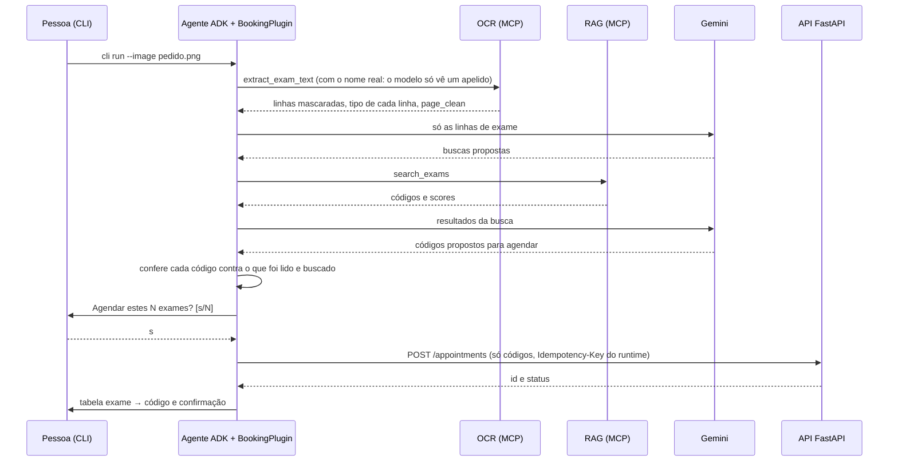

# Arquitetura

**O que tem aqui / quando ler.** Como as partes se encaixam e por quê, em poucas telas. Leia antes de mexer no código.

- **Aqui:** as etapas, o caminho de um pedido e o porquê dos servidores à parte, da máscara de PII, das camadas de
  segurança e do agendamento decidido em código.
- **Em outro lugar:** os detalhes de cada parte (tabelas, limites, mensagens), em [referencia.md](referencia.md); o
  porquê de cada escolha, em [decisoes.md](decisoes.md); os comandos, em [como-rodar.md](como-rodar.md).

**Índice:** [Visão geral](#visão-geral) · [Etapas](#etapas) · [O caminho de um pedido](#o-caminho-de-um-pedido) ·
[Por que OCR e RAG são servidores à parte](#por-que-ocr-e-rag-são-servidores-à-parte) ·
[Por que a PII não chega ao modelo](#por-que-a-pii-não-chega-ao-modelo) ·
[Por que a segurança vem em camadas](#por-que-a-segurança-vem-em-camadas) ·
[Por que o código decide o agendamento](#por-que-o-código-decide-o-agendamento) ·
[Tratamento de erros](#tratamento-de-erros)

## Visão geral

O sistema tem duas metades:

- **O transpilador** ([`transpiler/`](../transpiler/)) lê uma spec JSON e gera um `agent.py` que só declara classes do
  Google ADK. Ele não executa nada do pedido.
- **O que roda o pedido:** o agente gerado, a biblioteca [`runtime/`](../runtime/) que ele importa, dois servidores MCP
  (OCR e RAG) e a API FastAPI.

A ideia central: **o modelo propõe, o código decide, a pessoa confirma**
([por quê](decisoes.md#o-modelo-propõe-o-código-decide-a-pessoa-confirma)). Só depois do "sim" a API é chamada.

## Etapas

| Etapa | Onde | O que faz |
|---|---|---|
| Transpilar | [`transpiler/`](../transpiler/) | Valida a spec, gera `generated/agent.py` e o importa antes de dizer OK |
| Extrair | [`mcp_servers/ocr.py`](../mcp_servers/ocr.py) | Lê a imagem e devolve só o texto mascarado ([as etapas](#por-que-a-pii-não-chega-ao-modelo)) |
| Buscar | [`mcp_servers/rag.py`](../mcp_servers/rag.py) | Corta cada linha em exames e acha os códigos no catálogo de 120 exames ([como](referencia.md#como-a-busca-corta-uma-linha)) |
| Conferir | [`runtime/callbacks.py`](../runtime/callbacks.py) | Aceita só códigos achados nas linhas lidas e monta a lista para a pessoa |
| Agendar | [`api/main.py`](../api/main.py) | Valida os códigos e grava, cifrado, o código e o nome do catálogo |

Cada etapa é um `LlmAgent` num `SequentialAgent`: `extract` → `search` → `schedule`. Cada um só vê as ferramentas que a
spec lhe dá (`tool_filter`) e passa a saída adiante pelo estado (`output_key`). A política fica num plugin do ADK, o
`BookingPlugin` ([`runtime/plugin.py`](../runtime/plugin.py)), que confere cada chamada de modelo e de ferramenta.
Componentes, um a um, com o que cada um não faz: [referencia.md](referencia.md#componentes).

## O caminho de um pedido

No diagrama, o **apelido** é o nome `pedido-1.png`, que o modelo recebe no lugar do nome real do arquivo.
`page_clean` diz se a página é só a lista ([glossário](glossario.md#resposta-do-ocr)).

Passo a passo, com as funções a ler primeiro: [guia-dev.md](guia-dev.md#o-caminho-de-um-pedido-no-código). Cada
chamada, com o que entra e o que sai: [referencia.md](referencia.md#fluxo-de-dados-de-uma-execução).

## Por que OCR e RAG são servidores à parte

O OCR e o RAG são servidores MCP via SSE, cada um no seu container. Ficar à parte do agente dá três coisas:

- **O texto original fica preso.** O container do OCR não tem internet nem porta no host, e só devolve texto já
  mascarado.
- **O agente só fala com quem foi permitido.** Ele se conecta com `McpToolset(connection_params=SseConnectionParams(url=...))`,
  com as URLs da spec, e só aceita hosts de `ALLOWED_HOSTS`, que quem implanta define.
- **Cada etapa vê só as suas ferramentas.** Pelo `tool_filter` da spec, o `extract` vê só a leitura do OCR, o `search` só a busca e o `schedule` só o agendamento.

Ferramentas, URLs, portas e como iniciar cada servidor: [referencia.md](referencia.md#servidores-mcp).

## Por que a PII não chega ao modelo

A máscara roda dentro do container do OCR, antes de qualquer modelo. Ela faz quatro coisas:

1. Classifica o que cada linha pede (exame, negação, preparo…), no texto como foi lido, ainda com as ordens.
2. Tira as ordens ao modelo escritas na imagem.
3. Mascara os dados pessoais.
4. Deixa sair só o que parece exame ou estrutura do pedido.

O Gemini recebe só as linhas de exame; as outras chegam como `[linha de texto livre omitida]`. A API grava só códigos e
nomes do catálogo. Assim, um dado pessoal que a máscara não reconheça ainda precisa parecer exame para sair. Cada etapa,
com os números: [referencia.md](referencia.md#onde-a-pii-é-mascarada).

## Por que a segurança vem em camadas

Nenhuma camada sozinha é prova: o OCR erra, as regras não cobrem ataques novos e o modelo pode ser enganado. Por isso
cada camada barra uma coisa diferente, da imagem ao banco:

| Camada | O que barra |
|---|---|
| Entrada | Foto ruim, recusada antes do OCR |
| Entrada | O nome do arquivo: ele não chega ao modelo |
| Texto da imagem | Ordens ao modelo |
| Texto da imagem | Dado de ferramenta tratado como instrução |
| Modelo | Nada: ele só propõe |
| Código | Código que nenhuma busca devolveu |
| Código | Dois exames no mesmo trecho da linha |
| Código | Leitura fraca do OCR |
| Pessoa | A lista inteira, antes da API |
| Rede | Hosts fora de `ALLOWED_HOSTS` |
| Rede | Saída do OCR e do RAG para a internet |
| Rede | Acesso à API de fora da máquina: a porta dela só é publicada em `127.0.0.1` |
| API e banco | Código fora do catálogo |
| API e banco | Agendamento em dobro, pela `Idempotency-Key` |
| API e banco | Dado em claro no disco: cada linha é cifrada |

Cada camada, com números e exemplos: [referencia.md](referencia.md#segurança-em-detalhe). Os limites de cada uma:
[decisoes.md](decisoes.md#limites).

## Por que o código decide o agendamento

Num pedido médico, a decisão precisa ser reprodutível. Por isso o modelo não chama a API direto: um callback
(`only_confident_codes`, em [`runtime/callbacks.py`](../runtime/callbacks.py)) roda antes, e ele:

1. Bloqueia código que nenhuma busca devolveu.
2. Dá a cada exame um trecho próprio da linha lida.
3. Calcula a confiança e aplica as [faixas de confiança](glossario.md#leitura-e-decisão-de-cada-exame).
4. Aplica as [regras de linha e de página](regras.md): uma linha que nega, que diz já feito ou de preparo não agenda.
5. Monta a lista e pede a confirmação nativa do ADK. Só um "sim" àquela lista, naquela chamada, agenda.

Com `--yes`, não há pergunta e só agendam os exames que as regras aceitam sozinhas. O fluxo da confirmação, ponto a
ponto: [transpilador.md](transpilador.md#a-confirmação-da-lista-confirmação-nativa-do-adk). Cada estado de um exame e as
mensagens: [referencia.md](referencia.md#agendamento-conferido-em-código).

## Tratamento de erros

Toda falha esperada termina numa linha `Erro: ...` em português, com o motivo e, quando existe, o que fazer; nenhuma
mostra stack trace. A tabela única, com cada aviso e cada erro, de onde vem e o que fazer:
[referencia.md](referencia.md#mensagens-e-erros). Falhas de ambiente (Docker, chave, portas):
[como-rodar.md](como-rodar.md#quando-algo-falha).
