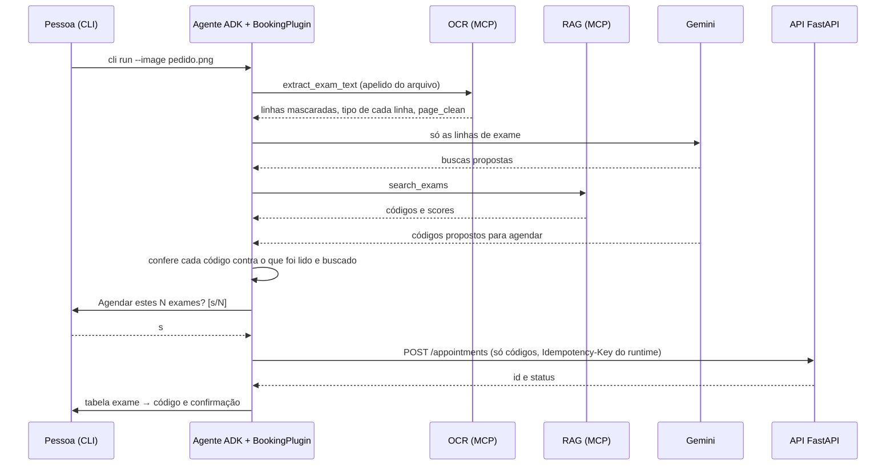

# Arquitetura

**O que tem aqui / quando ler.** Como as partes se encaixam, em poucas telas: as etapas, o caminho de um pedido, onde a
PII é mascarada, as camadas de segurança e como o agendamento é conferido. Leia antes de mexer no código. Os detalhes de
cada parte (tabelas, limites, mensagens) estão em [referencia.md](referencia.md); o porquê de cada escolha, em
[decisoes.md](decisoes.md); os comandos, em [como-rodar.md](como-rodar.md).

**Índice:** [Visão geral](#visão-geral) · [Etapas](#etapas) · [O caminho de um pedido](#o-caminho-de-um-pedido) ·
[Servidores MCP](#servidores-mcp) · [Onde a PII é mascarada](#onde-a-pii-é-mascarada) ·
[Segurança em detalhe](#segurança-em-detalhe) · [Agendamento conferido em código](#agendamento-conferido-em-código) ·
[Tratamento de erros](#tratamento-de-erros)

## Visão geral

O sistema tem duas metades:

- **O transpilador** ([`transpiler/`](../transpiler/)) lê uma spec JSON e gera um `agent.py` que só declara classes do
  Google ADK. Ele não executa nada do pedido.
- **O que roda o pedido:** o agente gerado, a biblioteca [`runtime/`](../runtime/) que ele importa, dois servidores MCP
  (OCR e RAG) e a API FastAPI.

A ideia central: **o modelo propõe, o código decide, a pessoa confirma.** O Gemini lê as linhas de exame já mascaradas e
propõe buscas e códigos. O código confere cada proposta contra o que foi lido e buscado. A pessoa vê a lista e responde
`Agendar estes N exames? [s/N]`. Só então a API é chamada.

## Etapas

| Etapa | Onde | O que faz |
|---|---|---|
| Transpilar | [`transpiler/`](../transpiler/) | Valida a spec, gera `generated/agent.py` e o importa antes de dizer OK |
| Extrair | [`mcp_servers/ocr.py`](../mcp_servers/ocr.py) | Prepara a imagem, lê com o Tesseract, classifica cada linha, tira ordens ao modelo e mascara a PII |
| Buscar | [`mcp_servers/rag.py`](../mcp_servers/rag.py) | Corta cada linha em exames e acha os códigos no catálogo de 120 exames ([como](referencia.md#como-a-busca-corta-uma-linha)) |
| Conferir | [`runtime/callbacks.py`](../runtime/callbacks.py) | Aceita só códigos achados nas linhas lidas e monta a lista para a pessoa |
| Agendar | [`api/main.py`](../api/main.py) | Valida os códigos e grava, cifrado, o código e o nome do catálogo |

Cada etapa é um `LlmAgent` num `SequentialAgent`: `extract` → `search` → `schedule`. Cada um só vê as ferramentas que a
spec lhe dá (`tool_filter`) e passa a saída adiante pelo estado (`output_key`). A política fica num plugin do ADK, o
`BookingPlugin` ([`runtime/plugin.py`](../runtime/plugin.py)), que confere cada chamada de modelo e de ferramenta.
Componentes, um a um, com o que cada um não faz: [referencia.md](referencia.md#componentes).

## O caminho de um pedido

Passo a passo, com as funções a ler primeiro: [guia-dev.md](guia-dev.md#o-caminho-de-um-pedido-no-código). Cada
chamada, com o que entra e o que sai: [referencia.md](referencia.md#fluxo-de-dados-de-uma-execução).

## Servidores MCP

O OCR e o RAG são servidores MCP via SSE, cada um no seu container, numa rede interna sem internet e sem porta no host.
O agente se conecta com `McpToolset(connection_params=SseConnectionParams(url=...))`, com as URLs da spec, e só aceita
hosts de `ALLOWED_HOSTS`. Ferramentas, URLs, portas e como iniciar cada um: [referencia.md](referencia.md#servidores-mcp).

## Onde a PII é mascarada

Dentro do container do OCR, antes de qualquer modelo. O texto original não sai de lá. Na ordem: tira as ordens ao
modelo, classifica o que cada linha pede, mascara os dados pessoais e deixa sair só o que parece exame ou estrutura do
pedido. O Gemini recebe só as linhas de exame; as outras chegam como `[linha de texto livre omitida]`. A API grava só
códigos e nomes do catálogo. As etapas da máscara, uma a uma: [referencia.md](referencia.md#onde-a-pii-é-mascarada).

## Segurança em detalhe

As camadas, da imagem ao banco:

- **Entrada:** a foto ruim é recusada antes do OCR; o nome do arquivo não chega ao modelo.
- **Texto da imagem:** ordens ao modelo são tiradas; dado de ferramenta nunca vale como instrução.
- **Modelo:** só propõe; o código aceita apenas códigos que uma busca devolveu, cada um num trecho próprio do pedido.
- **Pessoa:** confirma a lista antes da API.
- **Rede:** hosts permitidos conferidos na conexão; OCR e RAG sem internet; API só em `127.0.0.1`.
- **API e banco:** só códigos do catálogo, `Idempotency-Key` do runtime, cifra por linha.

Cada camada, com números e exemplos: [referencia.md](referencia.md#segurança-em-detalhe). Os limites de cada uma:
[decisoes.md](decisoes.md#limites).

## Agendamento conferido em código

O agendamento passa por um callback antes da API (`only_confident_codes`, em
[`runtime/callbacks.py`](../runtime/callbacks.py)):

1. Bloqueia código que nenhuma busca devolveu.
2. Dá a cada exame um trecho próprio da linha lida.
3. Calcula a confiança e aplica as [faixas de confiança](glossario.md#leitura-e-decisão-de-cada-exame).
4. Aplica as [regras de linha e de página](regras.md): uma linha que nega, que diz já feito ou de preparo não agenda.
5. Monta a lista e pede a confirmação nativa do ADK. Só um "sim" àquela lista, naquela chamada, agenda.

Com `--yes`, não há pergunta e só agendam os exames que as regras aceitam sozinhas. O fluxo da confirmação, ponto a
ponto: [transpilador.md](transpilador.md#a-confirmação-da-lista-confirmação-nativa-do-adk). Cada estado de um exame e as
mensagens: [referencia.md](referencia.md#agendamento-conferido-em-código).

## Tratamento de erros

Toda falha esperada termina numa linha `Erro: ...` em português, com o motivo e, quando existe, o que fazer; nenhuma
mostra stack trace. A tabela única, com cada aviso e cada erro, de onde vem e o que fazer:
[referencia.md](referencia.md#mensagens-e-erros). Falhas de ambiente (Docker, chave, portas):
[como-rodar.md](como-rodar.md#quando-algo-falha).
