# Gravações

Um vídeo por parte do sistema, numa execução real e sem cortes. Os players ficam em [videos.md](../videos.md).

- **Como foi gravado:** um navegador headless (Playwright) usa a aplicação de verdade: um terminal web para a CLI e o
  Swagger com cliques reais.
- **Velocidade:** as esperas longas (Gemini, `docker compose run`, `pytest`, a carga) aparecem aceleradas. Cada comando
  e cada resultado aparecem em velocidade normal ([aceleração e modelo](#data-commit-e-modelo)).
- **Na tela:** não há slides nem narração. Só o 00 tem uma barra de etapas no topo e notas curtas com os resultados
  que o próprio gravador conferiu na saída.
- **Miniatura:** o último frame de cada vídeo, que mostra a prova. No 00, o 1º frame (o pedido manuscrito).
- **Confirmação:** cada execução que agenda roda num terminal de verdade. A CLI mostra a lista e pergunta
  `Agendar estes N exames? [s/N]`. A gravação responde "s", e só então a CLI chama a API. No 12, o console do ADK
  mostra a mesma lista em `[HITL confirm]` e espera "yes".

| Parte do sistema | Vídeo (clique na miniatura) | Duração | O que prova |
|---|---|---|---|
| Visão geral | [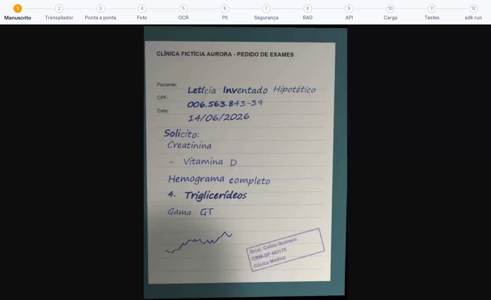](00-visao-geral.mp4) | 6:31 | Os 12 vídeos numa sequência só, 1,4x mais rápidos ([detalhes](#00-visao-geral)) |
| Transpilador | [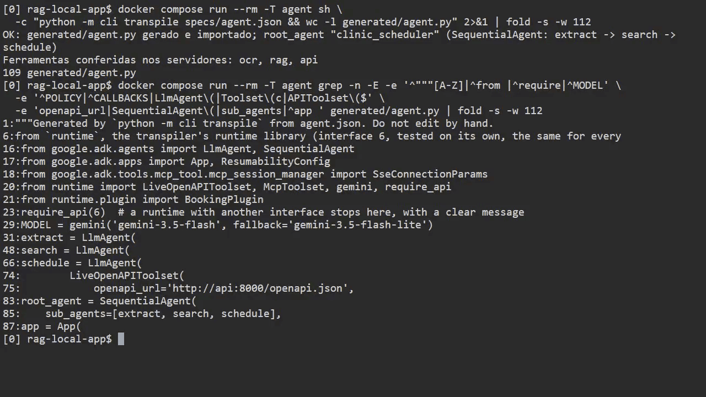](01-transpilador.mp4) | 1:18 | Uma spec válida vira `generated/agent.py`; uma com campo extra ou chave duplicada recebe erro claro |
| OCR via MCP (SSE) | [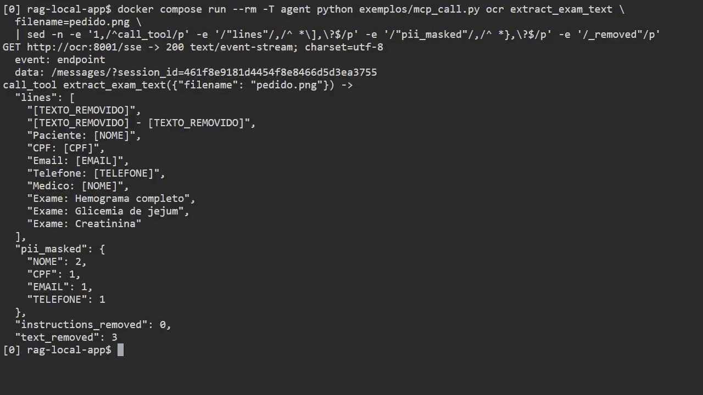](02-ocr-mcp-sse.mp4) | 0:20 | `extract_exam_text` lê `pedido.png` pelo SSE e devolve as linhas com a PII já mascarada |
| RAG via MCP (SSE) | [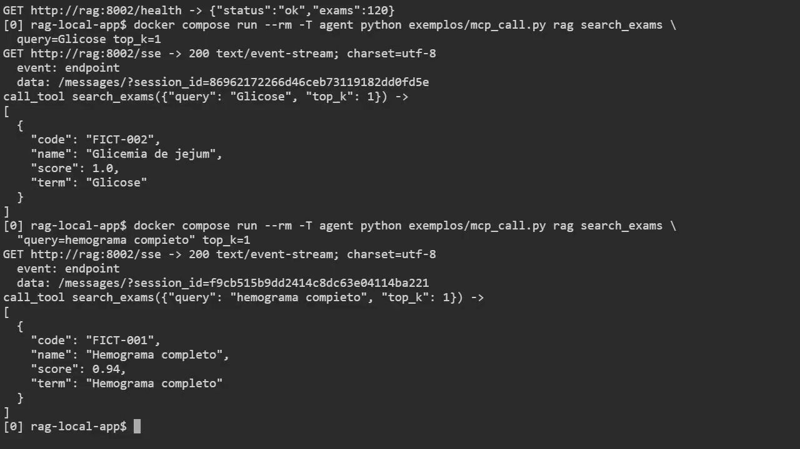](03-rag-mcp-sse.mp4) | 0:35 | `search_exams` acha o código com sinônimo e com erro de digitação, num catálogo de 120 exames |
| API e Swagger | [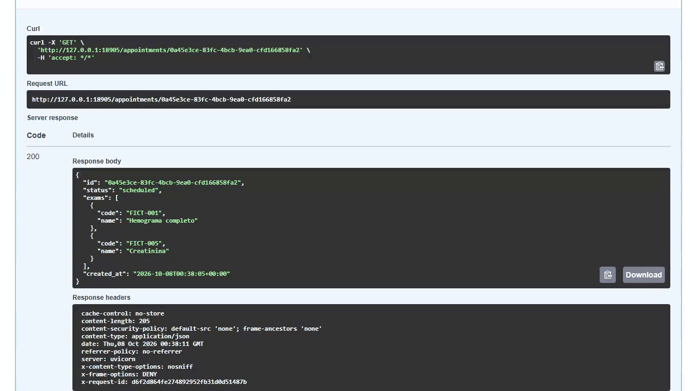](04-api-swagger.mp4) | 0:17 | No `/docs`, `POST /appointments` devolve 201, e o `GET` acha o agendamento pelo id |
| Fluxo ponta a ponta | [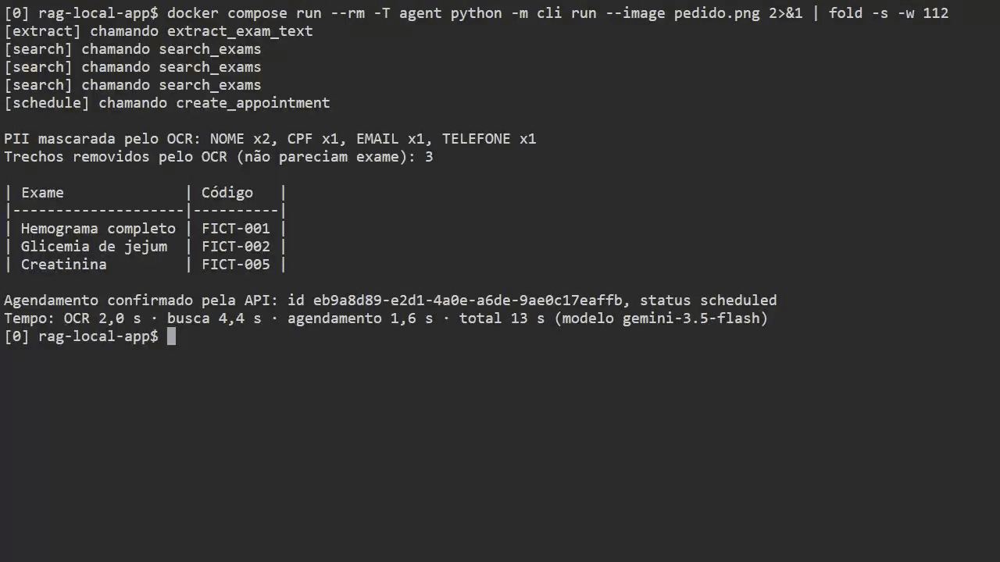](05-ponta-a-ponta.mp4) | 0:36 | Com o Gemini, `run --image pedido.png` vai do OCR à API e agenda 3 exames ([detalhes](#05-ponta-a-ponta)) |
| Camada de PII | [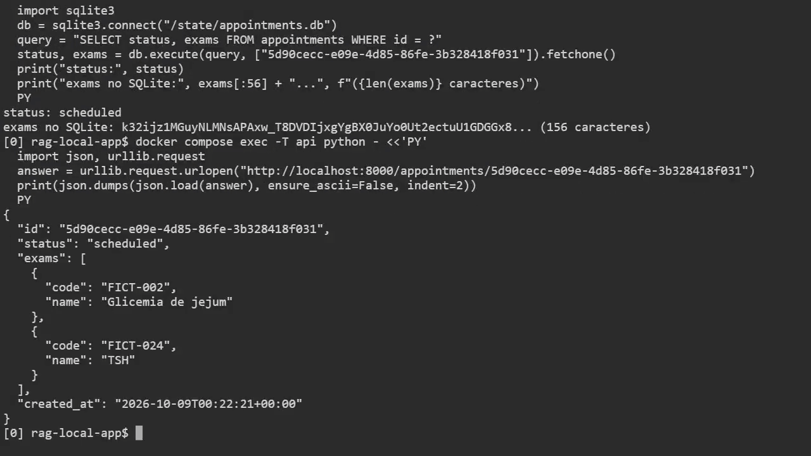](06-pii.mp4) | 1:13 | Só marcadores (`[NOME]`, `[CPF]`…) saem do OCR, e a lista de exames fica cifrada no SQLite ([detalhes](#06-pii)) |
| Docker e testes | [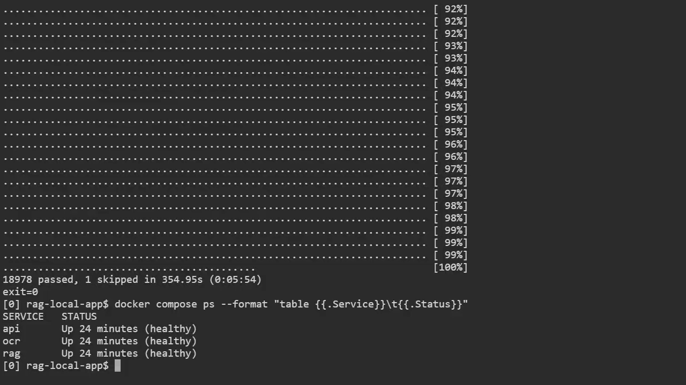](07-docker-testes.mp4) | 0:31 | Os serviços ficam healthy, e a suíte inteira passa no serviço `tests` ([detalhes](#07-docker-testes)) |
| Segurança contra injeção | [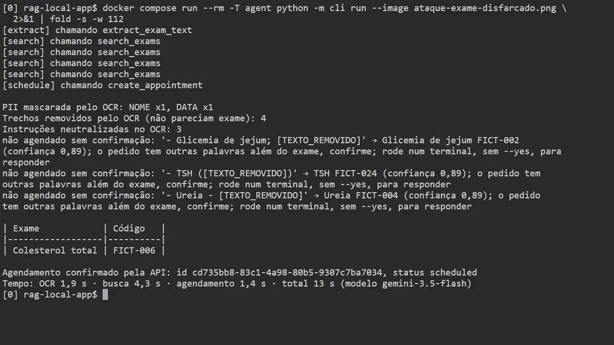](08-seguranca.mp4) | 1:34 | Nos pedidos com instruções escondidas, só os exames legítimos são perguntados e agendados ([detalhes](#08-seguranca)) |
| Dados sensíveis em carga | [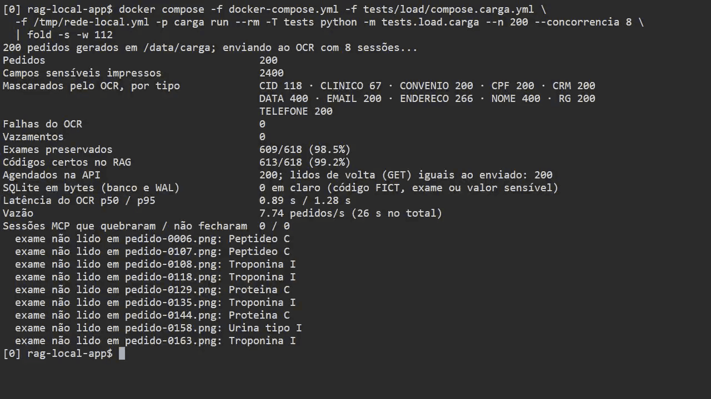](09-dados-sensiveis.mp4) | 0:55 | 200 pedidos com dados pessoais fictícios passam pelo OCR, RAG e API com 0 vazamentos ([detalhes](#09-dados-sensiveis)) |
| Pedido manuscrito | [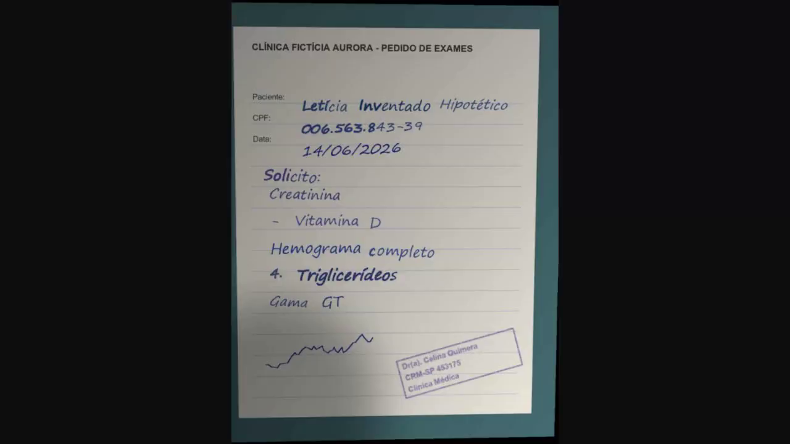](10-manuscrito.mp4) | 0:24 | Na letra de mão simulada, os 5 exames vão para a lista com `confira` e são agendados depois do "s" ([detalhes](#10-manuscrito)) |
| Foto de celular | [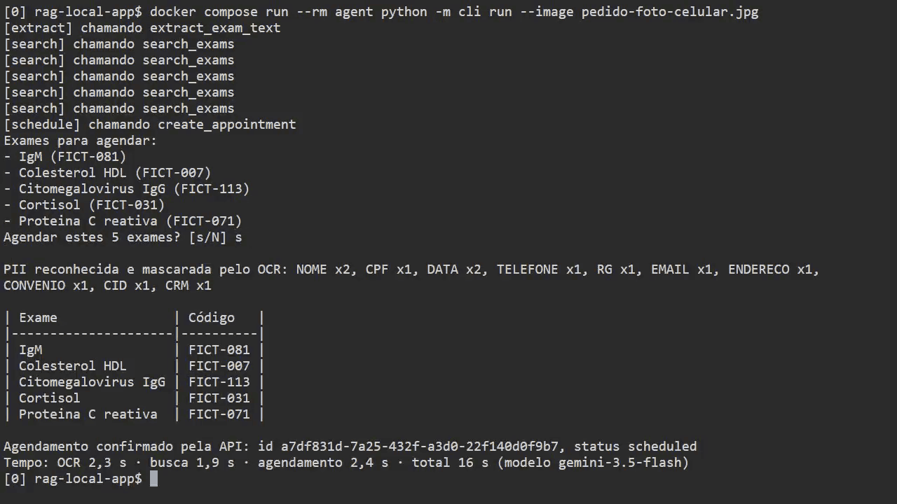](11-foto-celular.mp4) | 0:24 | Numa foto de celular simulada de um pedido impresso, os 5 exames são agendados depois do "s" ([detalhes](#11-foto-celular)) |
| ADK sem a CLI | [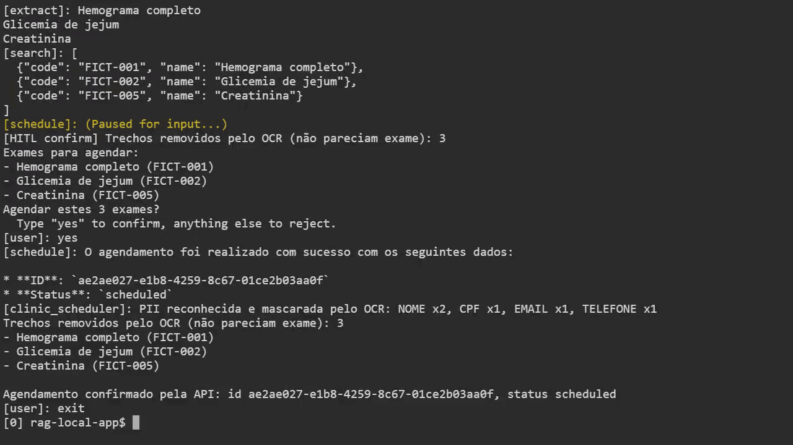](12-adk-run.mp4) | 0:41 | O mesmo agente, no console do Google ADK, mostra a lista, espera "yes" e agenda ([detalhes](#12-adk-run)) |

## Detalhes de alguns vídeos

**00. Visão geral.**

- Os 12 vídeos vão do pedido manuscrito (10) ao `adk run` (12), na ordem 10, 01, 05, 11, 02, 06, 08, 03, 04, 09, 07
  e 12.
- Uma barra de etapas no topo destaca a parte atual, e uma nota abre cada parte.
- As notas de resultado só repetem o que o gravador conferiu na saída real, com a linha da prova destacada. Cada
  pergunta da lista tem a sua nota.
- Os 2 primeiros segundos (o pedido manuscrito, que é a miniatura) e os 2 últimos de cada parte (a prova) vão em
  velocidade normal.

**05. Fluxo ponta a ponta.**

- `run --image pedido.png` com o Gemini: OCR, RAG, a lista dos 3 exames e a pergunta `Agendar estes 3 exames? [s/N]`.
- Respondida "s", a CLI chama a API e mostra a tabela exame → código, a confirmação e o tempo de cada etapa.
- O total da linha `Tempo:` passa bem da soma das etapas ([por quê](../como-rodar.md#3-executar-o-agente)).

**06. Camada de PII.**

- Um pedido realista: só marcadores (`[NOME]`, `[CPF]`…) no OCR e no `run`.
- No SQLite, a coluna de exames do agendamento está cifrada. A tela mostra o começo dela e o tamanho.
- O `GET` devolve os exames decifrados.
- A lista perguntada tem 2 dos 4 exames (Glicemia de jejum e TSH), agendados depois do "s".
- Colesterol total (0,68) e Hemoglobina glicada (0,60) aparecem em `Não agendados`, com `baixa confiança`, para
  conferência humana. É o comportamento conservador esperado.
- O OCR mostra `text_removed: 2` num pedido legítimo. São os 2 trechos do cabeçalho da clínica
  (`CLÍNICA FICTÍCIA HORIZONTE - DADOS FICTÍCIOS`): a rede de segurança tira do texto o que não parece exame nem
  estrutura do pedido.

**07. Docker e testes.**

- `docker compose ps` mostra os serviços healthy, antes e depois da suíte.
- A suíte inteira roda no serviço `tests`: `19378 passed` na gravação.
- `exit=0` é o código de saída do próprio `pytest`.
- O `1 skipped` é o teste ponta a ponta, que precisa da chave Gemini.

**08. Segurança contra injeção.**

- Os testes do corpus de injeção e de PII passam.
- Nos pedidos com instruções escondidas (`ataque-injecao.png`, `ataque-exame-disfarcado.png`), o OCR conta as
  instruções (`instructions_removed`) e tira o texto delas (`[TEXTO_REMOVIDO]`).
- A lista perguntada pelo `run` traz só os exames legítimos: 3 no 1º pedido e 4 no 2º. Todos vêm marcados `confira`,
  porque a página tem texto além da lista.
- No 2º pedido, 3 exames dividiam a linha com uma instrução removida. Eles dizem também
  `o pedido tem outras palavras além do exame`.
- Respondida "s", só os exames legítimos são agendados.
- O cabeçalho (`Laboratorio Ficticio Beta`, `PEDIDO MEDICO FICTICIO`) também sai como `[TEXTO_REMOVIDO]`. Não é
  instrução: a rede de segurança só deixa sair do OCR o que parece exame ou estrutura do pedido.
- Por isso a tela mostra um `[TEXTO_REMOVIDO]` a mais que o `instructions_removed`: 5 contra 4, e 4 contra 3.
  - `instructions_removed` conta só as instruções escondidas.
  - `text_removed` conta todos os trechos removidos, o título incluído.

**09. Dados sensíveis em carga.**

- A tela mostra a imagem de um pedido do gerador da carga (fictícia, com nome realista e CPF falso) e a saída do OCR
  para ele. Nome, CPF, RG, endereço, carteirinha e CRM saem mascarados.
- Depois, a carga com 200 pedidos passa pelo OCR, RAG e API:
  - 0 falhas do OCR e 0 vazamentos;
  - os 200 agendamentos lidos de volta iguais ao enviado;
  - nada em claro nos bytes do SQLite.
- `Mascarados pelo OCR` (2451) passa dos 2400 `Campos sensíveis impressos`, por dois motivos:
  - a data do pedido também sai como `[DATA]` (DATA 400: nascimento e data do pedido);
  - endereço e CEP na mesma linha saem num só `[ENDERECO]`.
- A tela também mostra os números parciais, perto de 99%: exames preservados no texto e códigos certos no RAG.
- Os poucos exames que o OCR não leu são listados pelo nome. Neles, falta uma letra ou sigla solta no fim do nome, como
  em "Troponina I" ([por quê](../medicoes.md#carga-de-dados-sensíveis)).

**10. Pedido manuscrito.**

- `run --image pedido-manuscrito.png` com o Gemini. A letra de mão é simulada com fonte, não escrita real.
- A página tem texto além da lista: as linhas 13 a 15, que o OCR tirou (`Atenção: …; confira o papel`). Por isso os 5
  exames vão para a lista marcados `confira`. Triglicerídeos vem com a confiança de leitura 0,71.
- `Agendar estes 5 exames? [s/N]` é respondido "s", e os 5 são agendados.
- A linha `[schedule] chamando create_appointment` aparece antes da pergunta. A confirmação nativa do ADK pausa dentro
  dessa chamada, e o `POST` só sai depois do "s".

**11. Foto de celular.**

- `run --image pedido-foto-celular.jpg` com o Gemini.
- A foto é simulada: a perspectiva e a sombra são geradas por `tests/load/fotos.py`.
- Os 5 exames escritos vão para a lista, e `Agendar estes 5 exames? [s/N]` é respondido "s".
- Os 5 são agendados, e a PII sai mascarada.

**12. ADK sem a CLI.**

- `adk run --in_memory generated` com o Gemini: o mesmo agente gerado, no console do Google ADK, sem a CLI do projeto.
- O agente recebe `pedido.png`. Os subagentes de leitura, busca e agendamento (`[extract]`, `[search]`, `[schedule]`)
  respondem um após o outro.
- Antes da API, o `[schedule]` pausa (`Paused for input`).
- O console mostra a lista em `[HITL confirm]`, com `Agendar estes 3 exames?` e `Type "yes" to confirm`.
- Depois do "yes", o resumo final traz a PII mascarada e a confirmação da API com o id. `exit` encerra.

### Como os comandos aparecem na tela

- Os vídeos 01, 02, 03, 06 e 08 usam os arquivos de [`exemplos/`](../../exemplos/):
  - o cliente MCP `mcp_call.py`, que chama uma ferramenta pelo SSE e imprime a resposta;
  - duas specs com erro de propósito (campo extra e chave duplicada).
- Comandos longos aparecem em mais de uma linha, com `\` no fim da linha, como no shell. Assim nenhuma palavra é
  cortada na borda do terminal.
- Pelo mesmo motivo, os comandos sem pergunta e com saída longa terminam em `| fold -s -w N`. Ele só quebra as linhas
  da saída entre palavras.
- Os comandos que perguntam precisam de um terminal de verdade, sem pipe. Com a saída num pipe, o `docker compose run`
  desliga o terminal, e a CLI não pergunta.
- Nesses comandos, o terminal web da gravação quebra as linhas longas entre palavras, sem mudar o texto. Uma palavra no
  fim da linha passa inteira para a seguinte.

Formato: H.264/yuv420p, cada arquivo com menos de 10 MB, miniatura `.png` com o último frame em 1280x720. O 00 tem
1280x784, com a barra de etapas acima do vídeo.

### Data, commit e modelo

- **Data e commit:** 2026-10-08, todos os vídeos e capturas no commit `828ac9c`. Ele está na tag
  `backup/main-antes-compacta-f16f26c`, porque o histórico de `main` foi compactado depois.
- **Porta:** gravado com `API_PORT=18905`, por isso a URL do Swagger mostra essa porta. O padrão é 8765.
- **Carga do 09:** usa `--n 200`, para a tabela inteira caber na tela. O comando de
  [`tests/load/compose.carga.yml`](../../tests/load/compose.carga.yml) usa 500.
- **Rede do 09:** usa um override de rede local ([Quando algo falha](../como-rodar.md#quando-algo-falha)), porque os
  pools de endereços do Docker da máquina da gravação estavam esgotados. Numa máquina comum, ele não é necessário.
- **Aceleração:** as esperas vão pelo menos 16x mais rápido.
  - Uma espera que nem a 16x caberia em 5 s passa mais rápido e ocupa 5 s: o `pytest` do 07, a carga do 09 e os `run`
    com o Gemini.
  - O 04 não tem espera longa.
- **Modelo:** todos os vídeos com o Gemini (05, 06, 08, 10, 11 e 12) usam o modelo principal da spec,
  `gemini-3.5-flash`.
  - Somam 7 execuções com o Gemini (o `run` ou o `adk run`), uma por pedido, sem tomada descartada.
  - O [teste de alucinação](../evidencias/log-alucinacao.txt) fez outras 4.
- **Duração:** cada vídeo de uma parte tem no máximo 1:34. O 00 junta todos em 6:31.
